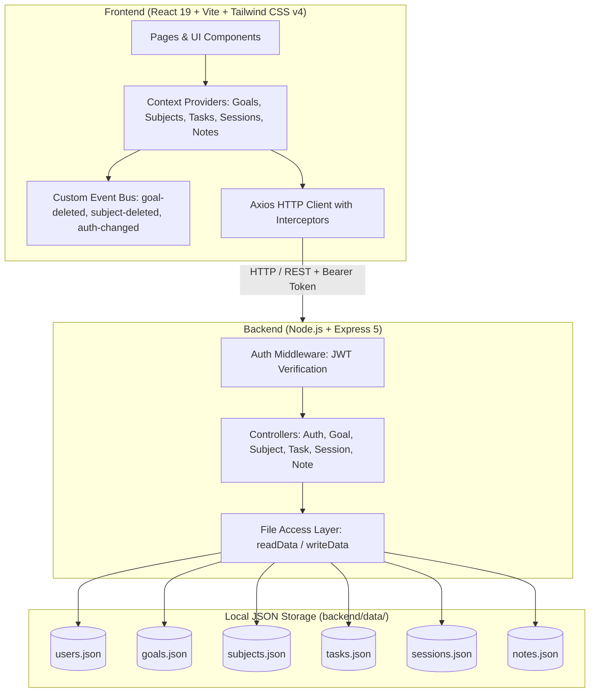
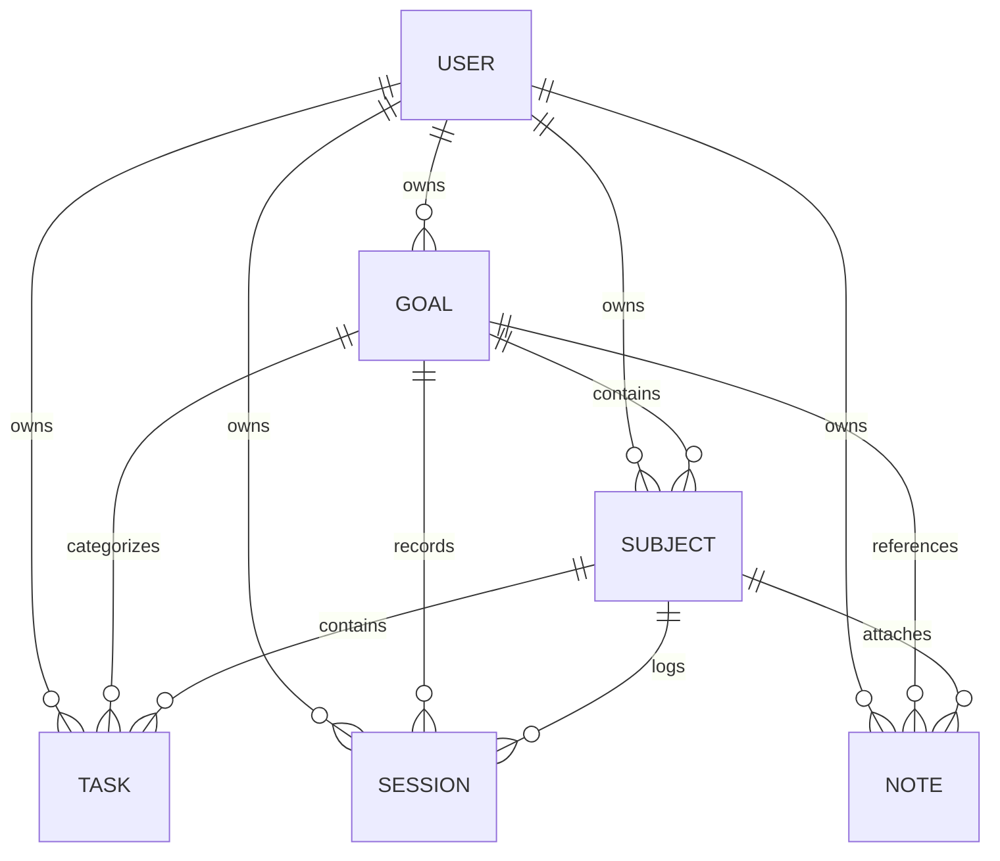

# Personal Learning Journey Tracker — Complete Technical Documentation

A comprehensive, full-stack personal education and goal-management application designed to organize learning objectives into hierarchical structures, log study sessions, track task progression, manage study notes with PDF attachments, and visualize progress through analytical reports and interactive calendars.

---

## Table of Contents

1. [Executive Summary](#1-executive-summary)
2. [High-Level Architecture](#2-high-level-architecture)
3. [Technology Stack](#3-technology-stack)
4. [Domain Model & Data Architecture](#4-domain-model--data-architecture)
   - [Hierarchical Relationship](#hierarchical-relationship)
   - [Entity Schemas](#entity-schemas)
   - [Cascading Delete Mechanism](#cascading-delete-mechanism)
   - [Storage Implementation](#storage-implementation)
5. [Authentication & Security Architecture](#5-authentication--security-architecture)
6. [API Specification & Endpoint Reference](#6-api-specification--endpoint-reference)
   - [System & Health](#system--health)
   - [Authentication Endpoints](#authentication-endpoints)
   - [Goal Management Endpoints](#goal-management-endpoints)
   - [Subject Management Endpoints](#subject-management-endpoints)
   - [Task Management Endpoints](#task-management-endpoints)
   - [Session Management Endpoints](#session-management-endpoints)
   - [Note Management Endpoints](#note-management-endpoints)
7. [Frontend Architecture & State Management](#7-frontend-architecture--state-management)
   - [Router & Protected Route Architecture](#router--protected-route-architecture)
   - [Context Hierarchy & Global State](#context-hierarchy--global-state)
   - [Cross-Context Event Bus](#cross-context-event-bus)
   - [Page Breakdown & Core Features](#page-breakdown--core-features)
   - [PDF Attachment Subsystem](#pdf-attachment-subsystem)
8. [Directory & File Structure](#8-directory--file-structure)
9. [Installation, Configuration & Running Guide](#9-installation-configuration--running-guide)
   - [Prerequisites](#prerequisites)
   - [Environment Variables](#environment-variables)
   - [Backend Execution](#backend-execution)
   - [Frontend Execution](#frontend-execution)
   - [Quality Assurance & Testing](#quality-assurance--testing)
10. [Technical Observations & Optimization Recommendations](#10-technical-observations--optimization-recommendations)

---

## 1. Executive Summary

The **Personal Learning Journey Tracker** is designed for learners, self-taught developers, and students who require an organized, distraction-free environment to plan and execute learning goals.

### Key Capabilities
- **Hierarchical Goal Tracking:** Organizes macro-level learning goals (e.g., "Full-Stack Development") into domain subjects (e.g., "React", "Express.js") and actionable tasks (e.g., "Implement JWT Auth").
- **Study Session Logging:** Tracks time invested in each subject with date-stamped duration tracking and notes.
- **Embedded Note-Taking with PDF Support:** Allows drafting study notes linked to goals or subjects, with direct support for PDF file attachments up to 5 MB encoded in Base64.
- **Visual Analytics & Reporting:** Aggregates task completion metrics, calculates percentage progress per goal, and sums total hours and minutes spent studying.
- **Interactive Calendar:** Visual monthly planner that identifies scheduled task deadlines and historical study sessions.
- **Zero-Database Setup:** Utilizes JSON file-based persistence, allowing instant execution in educational and local development environments without provisioning MongoDB, PostgreSQL, or external databases.

---

## 2. High-Level Architecture

The project adheres to a decoupled client-server architecture:



---

## 3. Technology Stack

### Frontend
| Component | Technology | Version | Purpose |
| :--- | :--- | :--- | :--- |
| **Framework** | React | `^19.3.1` | Core UI library using functional components and hooks |
| **Runtime / Bundler** | Vite | `^8.3.6` | High-performance dev server and production builder |
| **Styling** | Tailwind CSS | `^4.3.5` | Utility-first styling via modern `@tailwindcss/vite` |
| **Routing** | React Router DOM | `^7.18.5` | Client-side routing, route guard protection, parameter routing |
| **HTTP Client** | Axios | `^1.21.1` | REST client with automated JWT request headers & 401 interception |
| **Code Quality** | ESLint | `^10.14.0` | Static analysis with React Hooks and React Refresh rules |

### Backend
| Component | Technology | Version | Purpose |
| :--- | :--- | :--- | :--- |
| **Platform** | Node.js | `>=20` | Server runtime operating in ECMAScript Modules (`"type": "module"`) |
| **Web Framework** | Express.js | `^5.3.0` | HTTP application server and REST route dispatcher |
| **Authentication** | JSON Web Tokens (`jsonwebtoken`) | `^9.0.3` | Stateless authorization tokens with 24-hour expiration |
| **Security** | `bcryptjs` | `^3.0.3` | Salted password hashing (10 salt rounds) |
| **CORS** | `cors` | `^2.8.6` | Cross-Origin Resource Sharing middleware |
| **Configuration** | `dotenv` | `^18.0.10` | Environment variable management from `.env` |
| **Development** | `nodemon` | `^3.1.14` | Hot reloading server during development |
| **Testing** | Node.js Test Runner (`node:test`) | Built-in | Zero-dependency integration testing |
| **Payload Capacity**| Express JSON body parser | `limit: "7mb"` | Accommodates 5 MB Base64-encoded PDF attachments |

---

## 4. Domain Model & Data Architecture

### Hierarchical Relationship

The data structure enforces a clean cascading hierarchy scoped to the authenticated user:



### Entity Schemas

#### 1. User (`users.json`)
```typescript
interface User {
  id: string;          // UUID v4 generated via crypto.randomUUID()
  name: string;        // Full name
  email: string;       // Normalized lowercase email (unique)
  password: string;    // Bcrypt salted hash (cost: 10)
  createdAt: string;   // ISO 8601 timestamp
}
```

#### 2. Goal (`goals.json`)
```typescript
interface Goal {
  id: string;          // UUID v4
  title: string;       // Goal title (required)
  description: string; // Detail / objective summary
  startDate: string;   // Format: YYYY-MM-DD
  targetDate: string;  // Format: YYYY-MM-DD
  userId: string;      // Foreign key referencing User.id
  completed: boolean;  // Completion state (default: false)
  createdAt: string;   // ISO 8601 timestamp
}
```

#### 3. Subject (`subjects.json`)
```typescript
interface Subject {
  id: string;          // UUID v4
  name: string;        // Subject title (required)
  description: string; // Subject description
  goalId: string;      // Foreign key referencing Goal.id
  userId: string;      // Foreign key referencing User.id
  createdAt: string;   // ISO 8601 timestamp
}
```

#### 4. Task (`tasks.json`)
```typescript
interface Task {
  id: string;          // UUID v4
  title: string;       // Task title (required)
  description: string; // Detailed instructions or criteria
  subjectId: string;   // Foreign key referencing Subject.id
  goalId: string;      // Foreign key referencing Goal.id
  userId: string;      // Foreign key referencing User.id
  dueDate: string;     // Format: YYYY-MM-DD
  completed: boolean;  // true if status is "Completed", else false
  status: "Not Started" | "In Progress" | "Completed";
  createdAt: string;   // ISO 8601 timestamp
}
```

#### 5. Session (`sessions.json`)
```typescript
interface Session {
  id: string;          // UUID v4
  title: string;       // Session label (defaults to Subject name)
  description: string; // Study notes / reflections
  subjectId: string;   // Foreign key referencing Subject.id
  goalId: string;      // Foreign key referencing Goal.id
  userId: string;      // Foreign key referencing User.id
  duration: number;    // Learning time in minutes (> 0)
  sessionDate: string; // Format: YYYY-MM-DD
  createdAt: string;   // ISO 8601 timestamp
}
```

#### 6. Note (`notes.json`)
```typescript
interface Note {
  id: string;          // UUID v4
  title: string;       // Note title (required)
  content: string;     // Note body text (required)
  subjectId: string;   // Optional foreign key to Subject.id
  goalId: string;      // Optional foreign key to Goal.id
  userId: string;      // Foreign key referencing User.id
  attachment?: {       // Optional PDF file attachment
    name: string;      // Filename ending in .pdf
    data: string;      // Data URI ("data:application/pdf;base64,...")
  } | null;
  createdAt: string;   // ISO 8601 timestamp
  updatedAt: string;   // ISO 8601 timestamp
}
```

### Cascading Delete Mechanism

To prevent orphaned records and data inconsistency, the backend enforces automated relational cascades:

1. **When a Goal is deleted (`DELETE /api/goals/:id`):**
   - The Goal is removed from `goals.json`.
   - All Subjects linked to `goalId` are deleted from `subjects.json`.
   - All Tasks linked to `goalId` (or the deleted subjects) are removed from `tasks.json`.
   - All Sessions linked to `goalId` (or the deleted subjects) are removed from `sessions.json`.
   - All Notes linked to `goalId` (or the deleted subjects) are removed from `notes.json`.

2. **When a Subject is deleted (`DELETE /api/subjects/:id`):**
   - The Subject is removed from `subjects.json`.
   - All Tasks matching `subjectId` are deleted from `tasks.json`.
   - All Sessions matching `subjectId` are deleted from `sessions.json`.
   - All Notes matching `subjectId` are deleted from `notes.json`.

### Storage Implementation

File operations are handled asynchronously in `backend/config/data.js` via Node.js `fs/promises`:
- `readData(fileName)`: Loads the target JSON file and parses it into JavaScript memory.
- `writeData(fileName, data)`: Serializes data using `JSON.stringify(data, null, 2)` and writes it atomically back to disk.

---

## 5. Authentication & Security Architecture

### Authentication Flow
1. **User Registration:**
   - Validates name, valid email syntax via regex (`/^[^\s@]+@[^\s@]+\.[^\s@]+$/`), and a minimum password length of 8 characters.
   - Normalizes email to lowercase.
   - Encrypts password using `bcryptjs.hash(password, 10)`.
   - Stores new user in `users.json`.

2. **User Login:**
   - Validates email and compares submitted plaintext password with stored hash via `bcryptjs.compare()`.
   - Generates a signed JWT token containing `{ id, email }` with a 24-hour expiration (`expiresIn: "1d"`).
   - Returns token and sanitized user profile (excluding hashed password).

3. **Client-Side Storage & Request Dispatch:**
   - Token is persisted in `localStorage` under key `"token"`.
   - Axios Request Interceptor automatically injects `Authorization: Bearer <token>` on all outgoing HTTP requests.

4. **Server-Side Token Verification:**
   - Middleware `protect` (`backend/middleware/authMiddleware.js`) intercepts requests.
   - Validates `Authorization` header structure.
   - Decodes token via `jwt.verify(token, process.env.JWT_SECRET)`.
   - Populates `req.user` with `{ id, email }`.
   - All controller queries strictly filter by `userId: req.user.id`, ensuring complete tenant isolation.

5. **Token Expiration / 401 Handling:**
   - Axios Response Interceptor detects any HTTP 401 error.
   - Removes expired tokens from `localStorage`.
   - Dispatches custom DOM event `"auth-changed"` to immediately transition the UI to the logged-out state and trigger redirect to `/login`.

---

## 6. API Specification & Endpoint Reference

Base URL: `http://localhost:5000/api`

### System & Health

| Method | Endpoint | Auth | Description |
| :--- | :--- | :---: | :--- |
| `GET` | `/` | No | Root health probe. Returns confirmation message string. |
| `GET` | `/api/protected` | Yes | Token validation check. Returns authenticated user payload. |

---

### Authentication Endpoints

#### 1. Register User
- **Endpoint:** `POST /api/auth/register`
- **Request Body:**
  ```json
  {
    "name": "Alex Mercer",
    "email": "alex@example.com",
    "password": "SecretPassword123"
  }
  ```
- **Responses:**
  - `201 Created`: User created successfully. Returns sanitized user record `{ id, name, email }`.
  - `400 Bad Request`: Validation failure (empty fields, password < 8 chars, invalid email).
  - `409 Conflict`: Email already exists.

#### 2. Login User
- **Endpoint:** `POST /api/auth/login`
- **Request Body:**
  ```json
  {
    "email": "alex@example.com",
    "password": "SecretPassword123"
  }
  ```
- **Responses:**
  - `200 OK`: Returns `{ message, token, user: { id, name, email } }`.
  - `400 Bad Request`: Missing email or password.
  - `401 Unauthorized`: Invalid credentials.

---

### Goal Management Endpoints

All Goal endpoints require `Authorization: Bearer <token>`.

| Method | Endpoint | Request Body | Status Codes | Description |
| :--- | :--- | :--- | :--- | :--- |
| `POST` | `/api/goals` | `{ title, description?, startDate?, targetDate? }` | `201`, `400`, `500` | Creates a new learning goal |
| `GET` | `/api/goals` | None | `200`, `500` | Retrieves all goals owned by current user |
| `GET` | `/api/goals/:id` | None | `200`, `404`, `500` | Retrieves a single goal by ID |
| `PATCH` | `/api/goals/:id`| `{ title?, description?, startDate?, targetDate?, completed? }` | `200`, `400`, `404` | Updates goal properties |
| `DELETE`| `/api/goals/:id`| None | `200`, `404`, `500` | Cascading delete of goal, subjects, tasks, sessions, and notes |

---

### Subject Management Endpoints

All Subject endpoints require `Authorization: Bearer <token>`.

| Method | Endpoint | Request Body | Status Codes | Description |
| :--- | :--- | :--- | :--- | :--- |
| `POST` | `/api/subjects` | `{ name, description?, goalId }` | `201`, `400`, `404` | Creates subject associated with user's goal |
| `GET` | `/api/subjects` | None | `200`, `500` | Retrieves all subjects for the user |
| `GET` | `/api/subjects/:id` | None | `200`, `404` | Retrieves a single subject |
| `PATCH` | `/api/subjects/:id`| `{ name?, description? }` | `200`, `404` | Updates subject details |
| `DELETE`| `/api/subjects/:id`| None | `200`, `404` | Cascading delete of subject and child tasks/sessions/notes |

---

### Task Management Endpoints

All Task endpoints require `Authorization: Bearer <token>`.

| Method | Endpoint | Request Body | Status Codes | Description |
| :--- | :--- | :--- | :--- | :--- |
| `POST` | `/api/tasks` | `{ title, description?, subjectId, goalId, dueDate?, status? }` | `201`, `400`, `404` | Creates task (`status`: "Not Started", "In Progress", "Completed") |
| `GET` | `/api/tasks` | None | `200`, `500` | Retrieves all tasks for the user |
| `GET` | `/api/tasks/:id` | None | `200`, `404` | Retrieves a single task |
| `PATCH` | `/api/tasks/:id`| `{ title?, description?, dueDate?, status?, completed?, goalId?, subjectId? }` | `200`, `400`, `404` | Updates task status, content, or parent IDs |
| `DELETE`| `/api/tasks/:id`| None | `200`, `404` | Removes single task |

---

### Session Management Endpoints

All Session endpoints require `Authorization: Bearer <token>`.

| Method | Endpoint | Request Body | Status Codes | Description |
| :--- | :--- | :--- | :--- | :--- |
| `POST` | `/api/sessions` | `{ title?, description?, subjectId, goalId, duration, sessionDate }` | `201`, `400`, `404` | Logs study time (duration > 0, date required) |
| `GET` | `/api/sessions` | None | `200`, `500` | Retrieves all learning sessions for user |
| `GET` | `/api/sessions/:id` | None | `200`, `404` | Retrieves session by ID |
| `PATCH` | `/api/sessions/:id`| `{ title?, description?, duration?, sessionDate?, goalId?, subjectId? }` | `200`, `400`, `404` | Updates logged session details |
| `DELETE`| `/api/sessions/:id`| None | `200`, `404` | Deletes learning session |

---

### Note Management Endpoints

All Note endpoints require `Authorization: Bearer <token>`.

| Method | Endpoint | Request Body | Status Codes | Description |
| :--- | :--- | :--- | :--- | :--- |
| `POST` | `/api/notes` | `{ title, content, goalId?, subjectId?, attachment? }` | `201`, `400`, `404` | Creates study note; attachment can be base64 PDF <= 5MB |
| `GET` | `/api/notes` | None | `200`, `500` | Retrieves all notes for user |
| `GET` | `/api/notes/:id` | None | `200`, `404` | Retrieves note by ID |
| `PATCH` | `/api/notes/:id`| `{ title?, content?, goalId?, subjectId?, attachment? }` | `200`, `400`, `404` | Modifies note content or PDF attachment |
| `DELETE`| `/api/notes/:id`| None | `200`, `404` | Deletes study note |

---

## 7. Frontend Architecture & State Management

### Router & Protected Route Architecture

Configured in `frontend/src/App.jsx` using React Router DOM:
- **Public Routes:** `/login`, `/register`.
- **Protected Layout:** Enforced by `<ProtectedRoute />` checking `localStorage.getItem('token')`. Unauthenticated traffic is redirected to `/login`.
- **Route Definitions:**
  - `/dashboard`: Primary statistics and active goals overview.
  - `/goals`: Goal management list and creation.
  - `/goals/edit/:id`: Edit target goal.
  - `/goals/:id/subjects`: Scoped subject management for a specific goal.
  - `/tasks` & `/tasks/:id`: Task tracking board and task editor.
  - `/subjects/:id/tasks`: Contextual task viewing for a selected subject.
  - `/sessions`: Study time tracker and session logs.
  - `/notes`: Study notes manager with PDF viewer/uploader.
  - `/calendar`: Visual schedule and daily activity inspector.
  - `/reports`: Analytical metrics, completion rates, and learning time aggregations.

### Context Hierarchy & Global State

The application wraps all routes inside 5 distinct React Context Providers in `frontend/src/main.jsx`:

```
<BrowserRouter>
  <GoalsProvider>
    <SubjectsProvider>
      <TasksProvider>
        <SessionsProvider>
          <NotesProvider>
            <App />
          </NotesProvider>
        </SessionsProvider>
      </TasksProvider>
    </SubjectsProvider>
  </GoalsProvider>
</BrowserRouter>
```

Each provider exposes state (`items`, `loading`, `error`) and mutation handlers (`add`, `update`, `delete`).

### Cross-Context Event Bus

To maintain state synchronization across distinct contexts without prop-drilling or large Redux stores, the frontend uses standard browser `CustomEvent` dispatchers:
- **`auth-changed`:** Fired on login, logout, or 401 token invalidation. Tells all contexts to re-fetch or clear user data.
- **`goal-deleted`:** Fired when a goal is deleted. Automatically purges child subjects, tasks, sessions, and notes from memory.
- **`subject-deleted`:** Fired when a subject is deleted. Purges linked tasks, sessions, and notes across all active contexts.

### Page Breakdown & Core Features

#### 1. Dashboard (`Dashboard.jsx`)
- Aggregates high-level metrics: Total Goals, Total Subjects, Total Tasks, Completed Tasks, Pending Tasks, Overall Progress %, Total Sessions, and Total Study Time (formatted as X hours Y minutes).
- Renders an interactive goal progress card list with animated progress bars.
- Provides immediate actions: Create Goal, Manage Subjects, Edit Goal, and Delete Goal with cascading confirmation.

#### 2. Goals (`Goals.jsx`)
- Create and edit form with real-time target date tracking.
- Progress calculation dynamically derived from the completion ratio of child tasks.

#### 3. Subjects (`Subjects.jsx`)
- Bound to route param `/goals/:id/subjects`.
- Form to add and edit subjects scoped specifically to the selected goal.
- Displays existing subjects with links to manage associated tasks.

#### 4. Tasks (`Tasks.jsx`)
- Dual-dropdown filter linking Goal -> Subject -> Task.
- Supports 3 operational statuses: `"Not Started"`, `"In Progress"`, `"Completed"`.
- Due date assignment for deadline tracking.

#### 5. Sessions (`Sessions.jsx`)
- Study time logging interface requiring goal, subject, duration in minutes, and session date.
- Chronological list of recorded learning blocks with edit and delete capabilities.

#### 6. Notes (`Notes.jsx`)
- Flexible note-taking tool allowing association with any Goal and Subject (optional).
- Integrated PDF file attachment widget.

#### 7. Calendar (`Calendar.jsx`)
- Custom monthly grid with previous/next month navigation.
- Automatically calculates Monday-starting weeks and days in month.
- Indicators marking dates that contain scheduled tasks or recorded sessions.
- Interactive day selection displaying date-specific tasks and study duration.

#### 8. Reports (`Reports.jsx`)
- Visual statistical cards comparing planned vs. completed work.
- Goal-by-goal analytical breakdown displaying individual progress meters and task counts.
- Total accumulated learning duration tracker.

### PDF Attachment Subsystem

```mermaid
sequenceDiagram
    actor User
    participant NotesUI as Notes.jsx
    participant FileReader as Browser FileReader
    participant Express as Express Backend
    participant NotesJSON as notes.json

    User->>NotesUI: Selects PDF file (< 5 MB)
    NotesUI->>NotesUI: Validates file type (.pdf) and file size (<= 5MB)
    NotesUI->>FileReader: readAsDataURL(file)
    FileReader-->>NotesUI: "data:application/pdf;base64,JVBERi0xLjc..."
    User->>NotesUI: Clicks "Save Note"
    NotesUI->>Express: POST /api/notes { title, content, attachment }
    Express->>Express: Validates Base64 prefix & decoded size <= 5MB
    Express->>NotesJSON: Writes note with embedded attachment
    Express-->>NotesUI: 201 Created { note }
    NotesUI-->>User: Displays Note with View & Download PDF buttons
```

1. **Client Validation:** File input restricts selection to `.pdf` and verifies `file.size <= 5 * 1024 * 1024`.
2. **Encoding:** Converted to a Base64 Data URL using `FileReader.readAsDataURL()`.
3. **Transmission:** Sent in JSON payload accommodated by Express `express.json({ limit: "7mb" })`.
4. **Server Validation:** `validateAttachment()` checks MIME prefix and base64 byte length.
5. **Consumption:** Rendered with standard `<a href={attachment.data} target="_blank">` for browser preview and `<a download>` for offline retrieval.

---

## 8. Directory & File Structure

```
personal-learning-journey-tracker/
├── .gitignore                     # Root gitignore (node_modules, .env, dist, logs, IDE files)
├── README.md                      # Quickstart documentation
├── PROJECT_DETAILS.md             # Complete technical architecture documentation
├── backend/                       # Node.js Express REST API
│   ├── .env                       # Environment secrets (PORT, JWT_SECRET)
│   ├── .env.example               # Environment variables template
│   ├── .gitignore                 # Backend-specific ignore rules
│   ├── app.js                     # Express application definition, routes, middleware
│   ├── server.js                  # HTTP server listener entry point
│   ├── package.json               # Backend dependencies and test scripts
│   ├── config/
│   │   ├── constants.js           # JSON data filenames definitions
│   │   └── data.js                # Async filesystem read/write helpers
│   ├── controllers/
│   │   ├── authController.js      # User registration, login, token generation
│   │   ├── goalController.js      # Goal CRUD and cascade deletion logic
│   │   ├── noteController.js      # Note CRUD and PDF attachment validation
│   │   ├── sessionController.js   # Study session CRUD and validation
│   │   ├── subjectController.js   # Subject CRUD and cascade deletion logic
│   │   └── taskController.js      # Task CRUD and status management
│   ├── data/                      # Local JSON persistence database
│   │   ├── goals.json             # Stored goal records
│   │   ├── notes.json             # Stored note records with base64 attachments
│   │   ├── sessions.json          # Stored study session records
│   │   ├── subjects.json          # Stored subject records
│   │   ├── tasks.json             # Stored task records
│   │   └── users.json             # Stored user accounts with bcrypt hashes
│   ├── middleware/
│   │   └── authMiddleware.js      # JWT token extraction and verification
│   ├── models/
│   │   ├── Goal.js                # Goal factory constructor
│   │   ├── Note.js                # Note factory constructor
│   │   ├── Session.js             # Session factory constructor
│   │   ├── Subject.js             # Subject factory constructor
│   │   ├── Task.js                # Task factory constructor
│   │   └── User.js                # User factory constructor
│   ├── routes/
│   │   ├── authRoutes.js          # /api/auth routes
│   │   ├── goalRoutes.js          # /api/goals routes
│   │   ├── noteRoutes.js          # /api/notes routes
│   │   ├── sessionRoutes.js       # /api/sessions routes
│   │   ├── subjectRoutes.js       # /api/subjects routes
│   │   └── taskRoutes.js          # /api/tasks routes
│   └── tests/
│       └── app.test.js            # Node native test suite for API endpoints
└── frontend/                      # React 19 + Vite SPA
    ├── .gitignore                 # Frontend-specific ignore rules
    ├── index.html                 # Single page application entry HTML
    ├── package.json               # Frontend dependencies and build scripts
    ├── vite.config.js             # Vite config with React and Tailwind plugins
    ├── eslint.config.js           # ESLint configuration
    ├── public/
    │   ├── favicon.svg            # Browser tab icon
    │   └── icons.svg              # SVG asset bundle
    └── src/
        ├── App.jsx                # Router and route table
        ├── main.jsx               # React DOM entry point with all Context Providers
        ├── index.css              # Global styles importing Tailwind CSS
        ├── api/                   # API interaction layer
        │   ├── api.js             # Axios instance with request/response interceptors
        │   ├── authService.js     # Login, register, logout helpers
        │   ├── goalService.js     # Goal REST calls
        │   ├── noteService.js     # Note REST calls
        │   ├── sessionService.js  # Session REST calls
        │   ├── subjectService.js  # Subject REST calls
        │   └── taskService.js     # Task REST calls
        ├── components/            # Reusable UI & route components
│   │   ├── Modal.jsx          # Reusable accessible dialog modal with backdrop blur
│   │   └── ProtectedRoute.jsx # Route authentication guard
        ├── context/               # React Context Providers
        │   ├── GoalsContext.jsx    # Goals state and mutations
        │   ├── NotesContext.jsx    # Notes state and mutations
        │   ├── SessionsContext.jsx # Sessions state and mutations
        │   ├── SubjectsContext.jsx # Subjects state and mutations
        │   └── TasksContext.jsx    # Tasks state and mutations
        └── pages/                 # Full-page views
            ├── Calendar.jsx       # Monthly calendar and day activity viewer
            ├── Dashboard.jsx      # High-level metrics, progress bars, active goals
            ├── Goals.jsx          # Goal editor and progress details
            ├── Login.jsx          # User login page
            ├── Notes.jsx          # Note editor with PDF attachment manager
            ├── Register.jsx       # User registration page
            ├── Reports.jsx        # Analytics and performance graphs
            ├── Sessions.jsx       # Learning session timer and history
            ├── Subjects.jsx       # Subject manager for a specific goal
            └── Tasks.jsx          # Task status and assignment board
```

---

## 9. Installation, Configuration & Running Guide

### Prerequisites
- **Node.js:** v18.0.0 or higher (v20+ recommended).
- **npm:** v9.0.0 or higher.

### Environment Variables

Create `backend/.env` in the `backend/` directory:

```env
PORT=5000
JWT_SECRET=super_secret_jwt_key_personal_learning_tracker_2026
```

### Backend Execution

1. Open a terminal and navigate to `backend/`:
   ```bash
   cd backend
   ```
2. Install dependencies:
   ```bash
   npm install
   ```
3. Start the development server (runs with nodemon on port 5000):
   ```bash
   npm run dev
   ```

### Frontend Execution

1. Open a second terminal and navigate to `frontend/`:
   ```bash
   cd frontend
   ```
2. Install dependencies:
   ```bash
   npm install
   ```
3. Launch the development server:
   ```bash
   npm run dev
   ```
4. Open your browser to the local Vite URL (typically `http://localhost:5173`).

### Quality Assurance & Testing

- **Run Backend Test Suite:**
  ```bash
  cd backend
  npm test
  ```
  Executes Node.js native test suite (`backend/tests/app.test.js`) verifying health probe, route protection, and token validation.

- **Run Frontend Linting:**
  ```bash
  cd frontend
  npm run lint
  ```
  Validates JSX formatting and React Hook dependencies with ESLint.

- **Run Frontend Production Build:**
  ```bash
  cd frontend
  npm run build
  ```
  Generates production-optimized JavaScript and CSS bundle in `frontend/dist/`.

---

## 10. Technical Observations & Optimization Recommendations

1. **Calendar Session Date Property Consistency:**
   - In `backend/models/Session.js` and `frontend/src/pages/Sessions.jsx`, session date is saved as `sessionDate`.
   - In `frontend/src/pages/Calendar.jsx`, lines 83 and 100 filter sessions by `session.date === selectedDate` and check `session.notes` instead of `session.description`.
   - *Recommendation:* Normalize `Calendar.jsx` to check `(session.sessionDate || session.date) === selectedDate` and `(session.description || session.notes)` so recorded learning sessions appear seamlessly on the calendar view.

2. **Database Scalability / Production Transition:**
   - The current file-based JSON storage (`backend/data/*.json`) is reliable for local, single-user learning.
   - For multi-user concurrent production deployments, concurrent file writes can cause race conditions.
   - *Recommendation:* The existing model factory structure (`createGoal`, `createTask`, etc.) makes it easy to migrate to MongoDB with Mongoose or PostgreSQL with Prisma by replacing `config/data.js` read/write calls with database queries.

3. **Storage of Large PDF Attachments:**
   - Currently, PDFs are base64-encoded directly into `notes.json`. While convenient for zero-dependency local use, storing multiple multi-megabyte files in JSON increases memory consumption during JSON parse/stringify cycles.
   - *Recommendation:* For larger-scale deployments, use `multer` to stream uploaded PDF files to local disk storage (`backend/uploads/`) or cloud object storage (e.g., AWS S3, Cloudflare R2), saving only the file reference URL in the database.

4. **Cleanup of Deprecated Templates & Empty Directories (Resolved):**
   - The redundant `frontend/template react` scaffold directory and empty unused folders (`frontend/src/layouts`, `frontend/src/services`, `frontend/src/utils`) have been removed, saving ~82 MB of disk space.
   - `ProtectedRoute.jsx` was cleanly extracted into `frontend/src/components/ProtectedRoute.jsx` to establish proper component separation.
   - Root `.gitignore`, `backend/.gitignore`, and `backend/.env.example` templates have been added.
