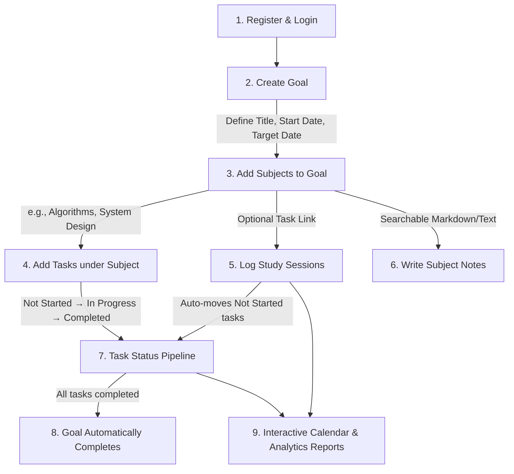

# Student Learning Workflow & Architecture Guide
**Personal Learning Journey Tracker**

This guide provides students and developers with a clear understanding of the application's architecture, data relationships, end-to-end workflow, and recent improvements.

---

## 1. Important Concept Clarification: "Lessons" vs. "Study Sessions"

> **Are "lessons" a separate feature?**  
> **No.** In this architecture, **"lessons" are modeled as "Study Sessions"**.

### Why This Design Works Best
Rather than creating duplicate concepts:
1. **Study Sessions** capture the actual time, date, and activity description of a study period (e.g., *“Completed Chapter 3 Exercises on Recursion”*).
2. **Task Linking**: Every study session can optionally link directly to a specific **Task** under a **Subject**.
3. **Automatic Progress Transition**: When a student logs a study session linked to a task that is *"Not Started"*, the system automatically updates that task's status to *"In Progress"*.
4. This gives students syllabus tracking (lessons learned) and time tracking in one cohesive model without unnecessary database bloat.

---

## 2. Target Workflow: The Learning Journey Lifecycle

The application is structured to guide students systematically through goal setting, curriculum planning, day-to-day execution, and progress review:



### Step-by-Step Flow:
1. **Register & Login**: Authenticate with JSON Web Tokens (JWT) stored securely in `localStorage`.
2. **Create Goal**: Define overarching milestones (e.g., *"Master Full-Stack Engineering"* or *"Prepare for Finals"*) with valid `startDate` and `targetDate`.
3. **Add Subjects**: Group your study domain into subjects (e.g., *"Data Structures"*, *"Databases"*, *"Frontend Architecture"*).
4. **Plan Tasks**: Add concrete action items under each subject with specific due dates.
5. **Log Sessions (Lessons)**: Record study time, select the subject, and optionally link the task worked on.
6. **Take Notes**: Record insights, references, and study notes directly tied to subjects.
7. **Track & Review**: Monitor pacing in **Reports**, check upcoming deadlines on the **Calendar**, and export study logs to CSV.

---

## 3. Core Architectural Rules & Relational Integrity

To eliminate bugs and ensure data consistency, the following patterns are enforced across the backend and frontend:

### A. Deriving `goalId` from `subjectId` (No Mismatches)
- **Problem**: When forms submitted both `goalId` and `subjectId` separately, selecting Subject X under Goal A while having Goal B selected in a dropdown created relational corruption.
- **Solution**: The backend controller treats `subjectId` as the primary parent. It fetches the subject and derives `goalId = subject.goalId` automatically.

### B. Single Source of Truth for Task Status
- **Problem**: Storing both `completed` (boolean) and `status` ("Not Started", "In Progress", "Completed") allowed conflicting states (e.g., `completed: false` with `status: "Completed"`).
- **Solution**: The `status` field is the sole authority. `completed` is derived dynamically:
  ```javascript
  completed = (status === 'Completed');
  ```

### C. Date Bounds Validation
- **Goals**: `targetDate >= startDate`.
- **Tasks**: `dueDate` must fall within the parent goal's `startDate` and `targetDate`.
- **Sessions**: `sessionDate` cannot be in the future, and `duration` cannot exceed 1,440 minutes (24 hours).
- **Overdue Flag**: Evaluated automatically:
  $$\text{isOverdue} = (\text{dueDate} < \text{today}) \land (\text{status} \neq \text{'Completed'})$$

### D. Safe Deletes with Relation Warning
Deleting a Goal or Subject cascades to remove child records (tasks, sessions, notes). To prevent accidental data loss, delete confirmations explicitly state the number of linked items that will be deleted.

---

## 4. Feature Walkthrough & Enhancements

### 1. Unified Modal Subsystem
All entity creation and modification forms (Goals, Subjects, Tasks, Sessions, Notes) now open in accessible modal dialogs:
- Clean overlay backdrop.
- Keyboard support (`Escape` key closes the modal).
- Click-outside-to-close behavior.
- Clean reset of form states upon closing.

### 2. Dedicated "My Subjects" View (`/subjects`)
Students can now view all subjects in one place:
- **Filter by Goal**: Dropdown to inspect subjects belonging to any goal or all goals.
- **Subject Progress**: Displays completed tasks vs. total tasks per subject.
- **Subject Study Time**: Summarizes total hours and minutes logged for that specific subject.

### 3. Calendar Bug Fix (`Calendar.jsx`)
- **Fixed**: Corrected field mappings from `session.date` and `session.notes` to `(session.sessionDate || session.date)` and `(session.description || session.notes)`.
- All past study sessions now appear properly on the calendar.

### 4. Searchable & Filterable Notes (`Notes.jsx`)
- **Live Search**: Instant keyword search across note titles and content.
- **Goal & Subject Filters**: Narrow notes down by specific goals or subjects.

### 5. Advanced Reports & Analytics Dashboard (`Reports.jsx`)
The Reports page provides comprehensive learning telemetry:
- **Date Range Filters**: Toggle between *All Time*, *Last 30 Days*, and *Last 7 Days*.
- **7-Day Study Bar Chart**: Visual CSS-rendered bar chart displaying study minutes for each of the last 7 days, along with average session duration.
- **Goal Pacing (On Track vs. Behind Schedule)**:
  $$\text{Time Elapsed \%} = \min\left(100, \max\left(0, \frac{\text{Now} - \text{Start}}{\text{Target} - \text{Start}} \times 100\right)\right)$$
  - **On Track**: $\% \text{ Tasks Completed} \ge \% \text{ Time Elapsed}$.
  - **Behind Schedule**: $\% \text{ Tasks Completed} < \% \text{ Time Elapsed}$.
- **Study Streak Counter**: Automatically calculates consecutive days with logged study sessions.
- **Time Allocation Charts**: Visual distribution of study hours across subjects and overarching goals.
- **Upcoming Deadlines**: Lists all tasks due within the next 7 days.
- **One-Click CSV Export**: Downloads a RFC 4180-compliant `.csv` report with dates, goals, subjects, durations, and notes.

### 6. Organic Forest & Matcha Color Theme (Pinterest Palette)
The application has been completely redesigned with an organic, calming botanical green color palette extracted from [Pinterest](https://pin.it/3SMugRcs0):

| Swatch / Shade | Hex Code | Semantic Role |
| :--- | :--- | :--- |
| **Deep Pine** | `#0F2A1D` | Sidebar navigation, main headings, dark badges |
| **Forest Moss** | `#375534` | Primary brand color, primary action buttons, active navigation states |
| **Sage Foliage** | `#6B9071` | Secondary accents, metric highlights, secondary badges |
| **Celadon Mist** | `#AEC3B0` | Card borders, subtle container outlines, inactive tags |
| **Matcha Cream** | `#E3EED4` | Soft pill backgrounds, progress bar tracks, badge fills |
| **Matcha Dew** | `#F4F8EE` | Global application canvas background |

---

## 5. Student Testing & Verification Checklist

Follow this checklist to verify your application workflow:

- [ ] **1. Authentication**
  - Register a new account (e.g., `student@test.com`).
  - Log in and verify that the JWT token is stored and redirects to Dashboard.

- [ ] **2. Goal Creation**
  - Click **"Create Goal"** (opens in modal).
  - Verify that selecting a target date earlier than the start date is rejected.
  - Create a valid goal (e.g., *Start: Today*, *Target: 30 days from now*).
  - Verify the goal displays the badge: `"Add subjects to start"`.

- [ ] **3. Subject Creation**
  - Add 2 subjects under your goal (e.g., *"Core Concepts"* and *"Projects"*).
  - Check the `/subjects` page and verify they appear under the goal filter.

- [ ] **4. Task Management**
  - Add 3 tasks under *"Core Concepts"*.
  - Verify that setting a due date outside the goal range produces an error message.
  - Leave Task 1 as *"Not Started"*, set Task 2 to *"In Progress"*, and Task 3 to *"Completed"*.

- [ ] **5. Study Session Logging (Lesson Workflow)**
  - Click **"Log Study Session"** modal.
  - Select *"Core Concepts"* and link it to Task 1 (*"Not Started"*).
  - Log a 45-minute session.
  - Return to Tasks and verify Task 1 has automatically advanced to *"In Progress"*.

- [ ] **6. Notes & Calendar**
  - Add a note under *"Core Concepts"*. Test the keyword search bar.
  - Open **Calendar** and verify that the 45-minute study session appears on today's date.

- [ ] **7. Reports & Analytics**
  - Open **Reports** (`/reports`).
  - Verify the 7-day bar chart shows 45 minutes for today.
  - Check the **Study Streak** (should show 1 day).
  - Check the **Goal Pacing** status (e.g., *On Track* or *Behind Schedule*).
  - Click **"Export CSV"** and verify that a `.csv` file downloads containing the logged session.

- [ ] **8. Goal Completion**
  - Mark all tasks under your goal as *"Completed"*.
  - Return to the Dashboard and verify the goal status pill updates to **"Completed"** (100%).
